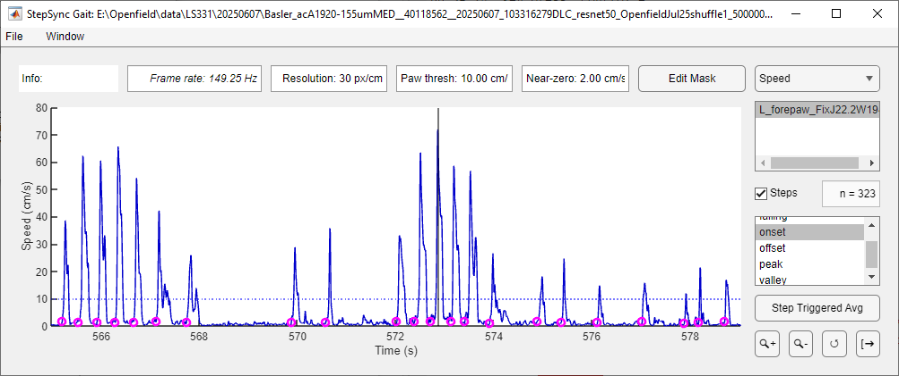
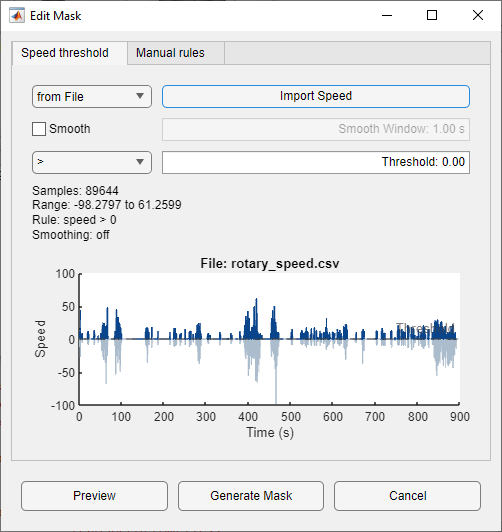

# Gait analysis

The Gait viewer turns paw trajectories into step events, such as swing onsets
or position peaks. A mask restricts the analysis to the periods you choose.
The events are shown in every viewer and are used by the
[step-triggered average](sta.md).

## Importing paws

`File > Import Pose` copies paw trajectories from the Pose viewer. If no pose
file is open there, it asks for one. Select one or more paws, typically the
corrected body parts saved by [Pose Fix](pose.md#correcting-tracking-errors).

When the paws come from the Pose viewer and you later edit or correct them
there, the Gait viewer asks whether to **Update** to the new data or **Keep**
the copy it has.

## Settings

| Control | Default | Description |
|---|---|---|
| Frame rate | — | The shared frame rate. Type a rate to override it, or clear it for automatic, e.g. when analysing a pose file without video or ephys data (see [Timing](synchronization.md)) |
| Resolution | 30 px/cm | Converts pixels to centimetres |
| Trace | X | `X`, `Y` (cm) or `Speed` (cm/s) |
| Paw thresh | automatic | Threshold for the selected paw and trace |
| Min interval | 0.2 s | Minimum time between peaks or valleys. Greyed out for rising and falling, which do not use it |
| Near-zero | automatic | Shown instead of *Min interval* when onset or offset is selected: the speed taken as rest, per paw. Automatic values are shown in italics; type a value to override, or clear the field to return to automatic |
| Paw list | | The paw to analyse |
| Steps | on | Show the events of the selected type in all viewers |
| n = | | Number of events of the selected type |
| Event list | | The event type to show and use for the STA |
| Edit Mask | | Open the mask editor |
| Step Triggered Avg | | Open the STA window |

Only the selected paw and trace are analysed. Changing either recomputes the
events.

**Speed** is the paw's displacement in the image, averaged over 3 frames and
smoothed with a 3-frame moving average. It is converted to cm/s using the
frame rate and the resolution.

**Threshold.** By default the threshold is the mean of the whole trace,
including masked frames, so it does not change when you edit the mask.
Typing a value sets a manual threshold for that paw and trace, and it is kept
when you switch back and forth. The threshold is drawn as a dotted line.

## Step events

All events are frame indices in the original video. Their times come from the
[shared frame times](synchronization.md).

| Event | Traces | Definition |
|---|---|---|
| rising | X, Y, Speed | Last frame at or below the threshold before the trace rises above it |
| falling | X, Y, Speed | First frame at or below the threshold after the trace was above it |
| onset | Speed | Movement onset: the last frame at rest before a rising crossing, searched back to the previous falling crossing |
| offset | Speed | Movement offset: the first frame at rest after a falling crossing, searched forward to the next rising crossing |
| peak | X, Y, Speed | Local maxima at or above the threshold |
| valley | X, Y, Speed | Local minima at or below the threshold |

For speed traces, **rising**/**falling** mark swing start and end at the
threshold level. **onset**/**offset** move these to the nearby moments when
the paw is truly at rest. For X or Y, **peak** and **valley** mark the
extremes of each stride.

Peaks and valleys must have a prominence of at least one standard deviation
of the trace, and be at least *Min interval* apart. Rising and falling
crossings have no minimum spacing.

### Rest level for onset and offset

The rest level is the *Near-zero* field. Set by hand, it applies to the
selected paw. Left empty, it is estimated from the speed trace itself:

1. The speed is smoothed over 0.15 s and log-compressed.
2. A histogram of the smoothed speed is searched for two modes, rest and
   movement, separated by a clear valley. If movement shows only as a
   shoulder with no valley, but the lowest mode is the largest, the cut is
   placed at that mode plus twice its half width (from its left flank).
3. Sustained stretches below the cut, each at least 0.15 s long, are
   taken as rest.
4. The rest level is the 75th percentile of the raw speed in those stretches.

If no clear rest period is found, the field stays empty, no onsets or offsets
are reported, and the reason is shown as a tooltip on the field. The estimate
is conservative; if events are missed, raise the value by hand.

## Masks

The mask decides which frames are analysed. Masked frames are drawn in grey.
Events cannot fall inside a masked period, and crossings, onset/offset
searches and peaks never span one. Each masked period is also listed as a
`masked` event at its first frame.

**Edit Mask** opens the mask editor, which has two tabs.

### Speed threshold

This tab keeps only frames where the animal's speed satisfies a rule, for
example running speed > 5 cm/s on a treadmill or in an open field.

| Control | Description |
|---|---|
| Source | `from Pose` (speed of a chosen body part, e.g. the tail base), `from File` or `from Workspace` |
| Import Speed | Load the speed from that source |
| Smooth / Smooth Window | Optional moving average (default 1 s) |
| Operator / Threshold | Keep frames where speed `>` or `<` the threshold |

Speed from a file or the workspace can be:

- **A vector** with one value per video frame.
- **A two-column matrix** `[time, speed]` on the shared clock. It is
  interpolated onto the frame times, and frames outside its time range are
  masked out.

Files may be `.mat` (a numeric variable) or `.csv`/`.txt`. Frames with no
speed value are masked out.

### Manual rules

This tab marks time ranges as **Good** or **Bad**. Each rule covers
*From* ≤ *t* < *To* seconds and can be enabled or disabled. Rules are applied
from top to bottom on top of the speed mask, so a later rule overrides an
earlier one. The buttons **Add**, **Update**, **Move up**, **Move down**,
**Duplicate**, **Delete** and **Clear all** edit the list.

### Applying

- **Preview** shows the mask on the gait trace without changing the analysis.
  With speed data loaded, it also draws the speed on a right-hand axis (black
  where it passes the threshold, gray where it fails; manual rules are not
  included) and the threshold as a dashed black line. Click **Preview** again
  after changing settings. **Generate Mask** or **Cancel** removes the right
  axis.
- **Generate Mask** applies it, recomputes the events and closes the editor.
- **Cancel** discards the changes.

The mask settings are stored, so the editor reopens as you left it.

## Saving

`File > Save` writes the paws, mask, settings and STA history to a `.mat`
file. `File > Open` reads it back and recomputes the events. See
[Sessions and files](files.md#gait-files).
