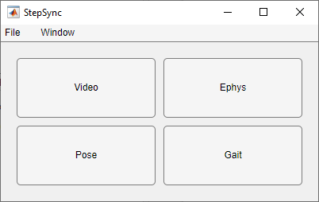

# Getting started

## Installation

1. Install MATLAB R2023a with the Signal Processing Toolbox.
2. Download or clone this repository:

   ```bash
   git clone https://github.com/JaegerLab/StepSync.git
   ```

3. To read Open Ephys recordings, also install
   [open-ephys-matlab-tools](https://github.com/open-ephys/open-ephys-matlab-tools)
   and add it to the MATLAB path. Intan recordings need nothing extra.

StepSync is organised as MATLAB packages (`+ephys`, `+pose`, `+gait`, `+video`,
`+shared`). Add only the repository root to the path, not the package folders:

```matlab
addpath('C:\path\to\StepSync')
```

## Starting StepSync

```matlab
StepSync
StepSync('D:\my_data')   % Use data location as an optional argument.
```

The optional argument is the folder where file dialogs first open. After that,
StepSync remembers the folder of the last file you opened or saved. If StepSync 
windows are already open, running `StepSync` again brings them to the front.



The launcher has one button per module: **Video**, **Ephys**, **Pose**
and **Gait**. Opening a module closes the launcher. After that, launch other modules 
from the Window menu (see below). 

## Windows and menus

Each module opens in its own window. The Video, Ephys, Pose and Gait windows
share one cursor time and one zoom window. Clicking a trace in any viewer
moves the cursor in all of them, and zooming in one zooms the others.

Every module window has the same menu bar.

**File**

| Item | Shortcut | Action |
|---|---|---|
| Open | Ctrl+O | Open a file for this module (Ephys: **Open File**) |
| Save | Ctrl+S | Save this module's data (see [Sessions and files](files.md)) |
| *(module-specific items)* | | Ephys: **Open folder**. Gait: **Import Pose** |
| Load session | | Replace everything with a saved session |
| Save session | | Save the open modules to one session file |
| Export to Workspace | | Put the session data in the MATLAB base workspace |
| Close | Ctrl+W | Close this window (asks first) |
| Exit all | | Close every StepSync window (asks first) |

**Window**

| Item | Shortcut |
|---|---|
| Ephys | Ctrl+E |
| Video | Ctrl+I |
| Pose | Ctrl+P |
| Gait | Ctrl+G |
| Open All | Ctrl+A |
| Bring All to Top | Ctrl+T |

A check mark shows which modules are open. Open tool windows (Ephys
Pre-Process, Pose auto fix, Edit Mask, Step-Triggered Average) are listed
indented under their module, and choosing one brings it to the front. On
macOS the shortcuts use Cmd instead of Ctrl.

When the last module window closes, the session ends and its data is cleared.
Save the session first if you need it.

Each module window reopens where it was last closed, also after MATLAB
restarts. The positions are kept in the MATLAB preferences (group
`StepSync`); `rmpref('StepSync')` resets them. A window last closed on a
monitor that is no longer connected opens on the nearest one. Loading a
session places the windows where the session saved them.

The Ephys, Pose and Gait viewers all have these buttons below their plot:

| Button | Action |
|---|---|
| 🔍︎+ / 🔍︎- | Halve / double the zoom window around the cursor, on the X axis only |
| ⭯ Refresh | Show the full recording and reset the vertical axis |
| [➜ Pop out | Copy the plot into an ordinary MATLAB figure, for export or editing |

## A first analysis

The order below is the usual one. Opening the ephys recording first means video and pose
frames are timed by the camera TTL pulses from the start.

1. **Ephys.** In the Ephys viewer, choose `File > Open` and select the folder
   that holds the recording. In the trigger menu, choose the digital channel
   that carries the camera trigger. The info line then shows the number of
   TTL pulses and their frequency. See [Ephys viewer](ephys.md).
2. **Preprocess** (optional). Click **Pre-Process**, check the settings,
   **Preview** one channel, then **Apply & Close**. The result appears as
   *Processed 1* in the data-type list.
3. **Video** (optional). In the Video viewer, choose `File > Open`. The video
   is shown on the ephys time base. See [Video viewer](video.md).
4. **Pose.** In the Pose viewer, choose `File > Open` and pick the pose file.
   Use **Pose Fix** to correct tracking errors and **Save As** the corrected
   body part. See [Pose viewer and correction](pose.md).
5. **Gait.** In the Gait viewer, choose `File > Import Pose` and select the
   paws. Set **Resolution** (pixels per cm), the trace (X, Y or Speed) and a
   threshold. Use **Edit Mask** to exclude periods you don't want to analyse.
   Step events appear as magenta circles in every viewer. See
   [Gait analysis](gait.md).
6. **STA.** Pick the ephys channel and data type in the Ephys viewer, and the paw
   and event type in the Gait viewer. Then click **Step Triggered Avg** and
   **Plot**. See [Step-triggered average](sta.md).
7. **Save.** `File > Save session` stores the data, settings and window
   positions of the modules you choose.

## Working with results in MATLAB

`File > Export to Workspace` puts the session in the base workspace under a
name you choose (default `data`). The variable is the live session object, not
a copy, so it keeps changing while StepSync runs:

```matlab
data.gait.paw(1).onset        % onset frame indices of the first paw
data.gait.t(data.gait.paw(1).onset)   % ...and their times in seconds
data.gait.sta(end)            % the most recent STA result
```

[Sessions and files](files.md) lists the fields.
