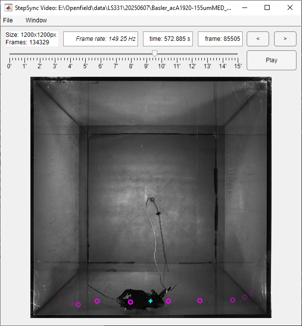

# Video viewer

The Video viewer plays the behaviour video on the shared timeline. It overlays
the selected pose marker and the detected steps, and exports a copy of the
video with those markers drawn in.

## Opening a video

`File > Open` (Ctrl+O) accepts any format MATLAB's `VideoReader` can read on
your system. The dialog lists `.mp4` files by default. The window title shows
the file name.

## Controls

| Control | Action |
|---|---|
| Info | Frame size and number of frames |
| Frame rate | The shared frame rate (see [Timing](synchronization.md)). Type a rate to override it; clear it for automatic |
| time | Cursor time in seconds; type a value to jump |
| frame | Current frame number; type a value to jump |
| `<` / `>` | Step back / forward by the step size |
| Ctrl+click `<` / `>` | Halve / double the step size (1, 2, 4, 8 or 16 frames, shown by the number of arrows) |
| Slider | Scrub through the video; ticks mark each minute |
| Play / Pause | Play from the current frame |

Playback advances by the step size on each update and never drops frames to
keep up with real time. The playback speed therefore depends on how fast your
computer draws frames. Use a larger step size to play faster. Playback stops
at the last frame that has a time.

## Overlays

| Marker | Meaning |
|---|---|
| Cyan **+** | The body part selected in the Pose viewer |
| Green **o** | The corrected position previewed by Pose Fix |
| Magenta rings | Steps of the selected paw and event type from the Gait viewer. Rings fade with their distance in time from the current frame |

You can drag the cyan or green marker with the mouse to correct the position
on the current frame. The pose data in the Pose viewer updates immediately.

## Exporting a marked video

`File > Save` (Ctrl+S) writes a new MPEG-4 video with the markers drawn into
the image:

1. Choose **Full length** or **Zoom window** (the current shared zoom range).
2. Choose the file name. The default is `<video>_StepSync.mp4`. The source
   video cannot be overwritten.
3. Enter the quality (0–100, default 80).

The export keeps the original resolution and is written at the session frame
rate. It contains the pose marker and step rings as they were when the export
started, without the green preview marker. Odd frame sizes are padded by one
pixel, as MPEG-4 requires. While exporting, the Play button shows
**Abort (n%)**. Aborting or closing the window keeps a playable partial file.
